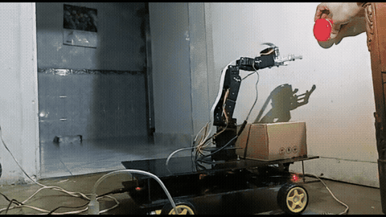
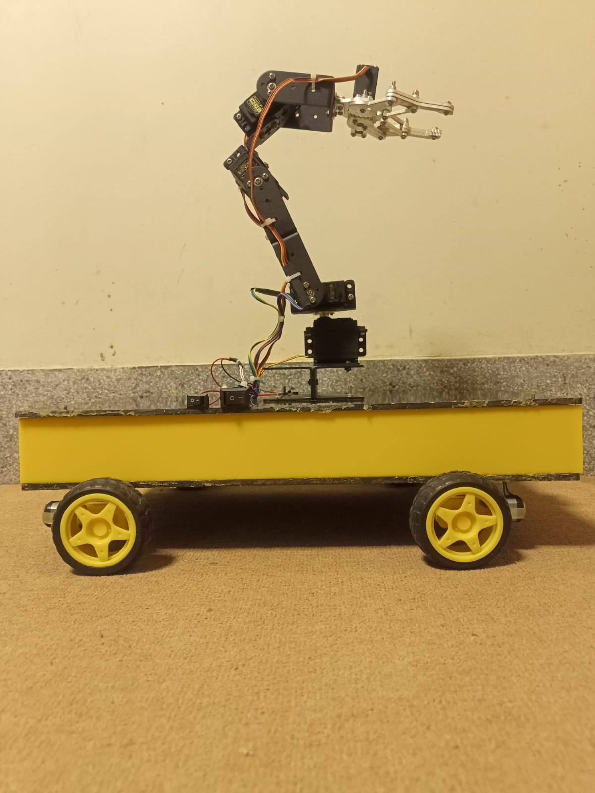
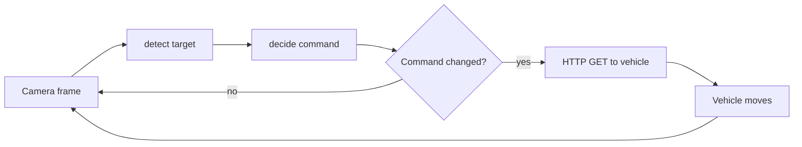
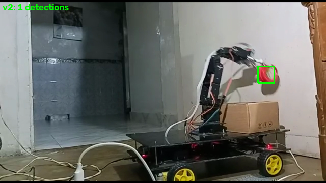

# Harvesting Robotic Vehicle

My final year project: a vision guided robotic vehicle with a 5 servo arm that finds a red target, aligns to it and picks it. This repository holds the original 2023 project code, and later work that tests and measures the vision and alignment logic.






## The project (2023)

Final year project, B.E. Electrical Engineering, Hamdard University, Karachi. Solo project, 2023, supervisor Engr. Sadiq Ur Rehman. The robot is a four wheel vehicle carrying a 5 servo arm. A Raspberry Pi 3B+ with a camera finds the target by colour, an ESP32 drives the arm servos, and an ultrasonic sensor sits on the vehicle. A companion Android app (not included, source not in the archive) was used to drive the robot from a phone.

What the code does:
1. The Raspberry Pi script ([`original/rpi_vision_original.py`](original/rpi_vision_original.py)) thresholds the camera frame in HSV, takes the largest red blob and compares its centre with the frame centre. It sends a right, left, advance, stop or pick command to the vehicle over HTTP, only when the state changes. Inside a 40 px dead band on both axes the intended command is the pick (`sa`); see the note below on the archived script. The camera then sees the new position, which closes the alignment loop.
2. The ESP32 firmware ([`original/esp32_arm_original.ino`](original/esp32_arm_original.ino)) maps pixel values to servo angles for base, shoulder, elbow and wrist, and runs the grip and lift sequence. The arm angles are an open loop mapping, with no feedback on the arm itself.



**Note on the archived script.** Reading the control flow carefully, the `sa` (pick) branch of `rpi_vision_original.py` cannot be reached: the edge trigger flag is always 0 by the time that branch runs, and a target centred in x but off in y makes the script alternate `f` and `s` each frame. I checked this by running the script's logic over every sequence of target positions (see [`docs/advancements.md`](docs/advancements.md)). The robot demonstrably picked in my trials, so the version that ran on it, or the way the pick was triggered, may differ from this archived file; I cannot tell which from the archive. The later work implements the intended behaviour.

The full design is in [my report](docs/FYDP_Report.pdf). The report describes the full design intent; this repository covers the code that exists in the project archive. The **obstacle avoidance code is not in the archive** and is not included. The vision script talks HTTP to a vehicle controller (also not in the archive) while the arm firmware listens on serial; the code that joins them is missing. Details: [`original/README.md`](original/README.md).

### Results reported in my final year report

Section 6.1 of the report, linked at [`docs/FYDP_Report.pdf`](docs/FYDP_Report.pdf). Measured on the physical robot, 100 trials each, counts only. Not reproduced by the code in this repository.

| item | reported |
|---|---|
| Detection | TP 120, FP 150, FN 10 (precision 44 %, recall 92 %) |
| Obstacle avoidance | 95 of 100 |
| Gripping | 90 of 100 |
| Harvesting | 85 of 100 |

## Later work

After the project I added a tested software layer around the same ideas ([`docs/advancements.md`](docs/advancements.md) lists what is new and what is kept):

- [`tomato_vision/`](docs/method.md): the vision and alignment logic as small, tested modules (OpenCV, HSV colour segmentation), with two hue ranges, mask cleanup, an area filter, an HTTP timeout and a `--dry-run` mode that needs no robot.
- [`tomato_vision/eval/`](docs/results.md): a reproducible evaluation on a public dataset, so the detector now has numbers anyone can rerun.
- [`tomato_vision/sim/`](docs/img/alignment_sim.png): a simulation of the alignment loop.



### Reproducible evaluation

Laboro Tomato test split (161 images, fully ripened fruit, IoU 0.5, each setting run once). The `original` row uses the settings of the 2023 project; `advanced` uses settings tuned on the train split. More in [`docs/results.md`](docs/results.md).

| settings | tp | fp | fn | precision | recall | F1 | hit@1 |
|---|---|---|---|---|---|---|---|
| original (2023 project) | 46 | 104 | 295 | 0.307 | 0.135 | 0.187 | 0.465 |
| advanced (tuned) | 106 | 161 | 235 | 0.397 | 0.311 | 0.349 | 0.485 |

The tuned settings find more ripe fruit, but both are weak on greenhouse photos: touching fruit merge, orange and half ripe fruit are counted as ripe, small distant fruit are missed. These numbers are on a public photo set, not on the robot, and are not comparable with the report figures above.

## Run it

```bash
python -m venv .venv && .venv/Scripts/activate   # Windows; use .venv/bin/activate elsewhere
pip install -r requirements.txt
pytest -q
python -m tomato_vision.app.detect_cli INPUT_DIR --preset advanced --out OUT_DIR
python -m tomato_vision.eval.run_eval --images data/laboro/laboro_tomato/test --annotations data/laboro/laboro_tomato/annotations/test.json --preset advanced --split-name test --out results/
python -m tomato_vision.app.live_tracker --camera 0 --preset original --dry-run
```

The dataset is not included; see [`data/README.md`](data/README.md).

## Limitations

- Colour only: reds near the fruit colour fool it, and touching tomatoes merge.
- One camera; distance is estimated from an assumed 4 cm object width and a 520 px focal length.
- The alignment plot is a simulation, not a measurement of the robot.
- The arm is open loop; "closed loop" applies only to the vehicle alignment.
- Obstacle avoidance is not included.
- The demo shows a red object, not a tomato.

## Dataset and licence

Evaluation uses [Laboro Tomato](https://github.com/laboroai/LaboroTomato) (CC BY-NC-SA 4.0, Laboro.AI Inc.). It is downloaded by the user and not redistributed here; no dataset image is committed. The code is MIT licensed ([`LICENSE`](LICENSE)).
