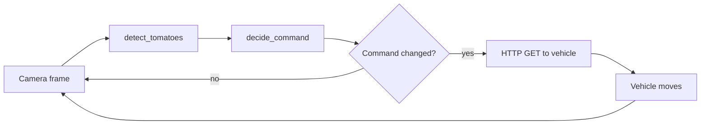

# Tomato Harvesting Robot: vision and alignment

Final year project code: tomato detection and vision guided alignment for a Raspberry Pi and ESP32 harvesting robot. The original code, a tested Python rebuild, and a reproducible evaluation.


## Background

This is my final year project (B.E. Electrical Engineering, Hamdard University, Karachi, solo project, 2023, supervisor Engr. Sadiq Ur Rehman). The robot is a four wheel vehicle carrying a 5 servo arm. A Raspberry Pi 3B+ with a camera finds a red target, an ESP32 drives the arm servos, and an ultrasonic sensor sits on the vehicle. A companion Android app (not included, source not in the archive) was used to drive the robot from a phone.

The full design is in [my report](docs/FYDP_Report.pdf). The report describes the full design intent; this repository covers the code that exists in the project archive. The **obstacle avoidance code is not in the archive** and is not included. The vision script talks HTTP to a vehicle controller (also not in the archive) while the arm firmware listens on serial; the code that joins them is missing.

## What is in this repo

1. [`original/`](original/README.md): my two original files, byte identical, with provenance.
2. [`tomato_vision/`](docs/method.md): a modular, tested rebuild of the same vision and alignment logic (OpenCV, HSV colour segmentation), with the fixes listed in [`docs/known_issues_original.md`](docs/known_issues_original.md).
3. [`tomato_vision/eval/`](docs/results.md): a reproducible evaluation of the detector on a public dataset, and a [simulation](docs/img/alignment_sim.png) of the alignment loop.

## How it works

1. Flip and brighten the frame, convert to HSV, keep red pixels (the rebuild uses two hue ranges because red wraps around the hue axis).
2. Clean the mask, take contours, drop small ones.
3. The target's centre is compared with the frame centre; inside a 40 px dead band on both axes the command is PICK, otherwise right, left or advance.
4. The command is sent to the vehicle over HTTP, only when it changes. The camera then sees the new position, closing the alignment loop.
5. The arm angles are an open loop mapping from pixel values to servo angles (no feedback on the arm itself).




## Results

**Table 1. Reproducible: this repository, Laboro Tomato test split (161 images, fully ripened fruit, IoU 0.5, each preset run once).** Details and the train split in [`docs/results.md`](docs/results.md).

| preset | tp | fp | fn | precision | recall | F1 | hit@1 |
|---|---|---|---|---|---|---|---|
| original (my script's detector) | 46 | 104 | 295 | 0.307 | 0.135 | 0.187 | 0.465 |
| v2 (rebuild, tuned on the train split) | 106 | 161 | 235 | 0.397 | 0.311 | 0.349 | 0.485 |

The rebuild is better than the original detector but both are weak on greenhouse photos: touching fruit merge, orange and half ripe fruit are counted as ripe, small distant fruit are missed.

**Table 2. Reported in my final year report (section 6.1, linked at [`docs/FYDP_Report.pdf`](docs/FYDP_Report.pdf)), measured on the physical robot, 100 trials each, counts only. Not reproduced by the code in this repository.**

| item | reported |
|---|---|
| Detection | TP 120, FP 150, FN 10 (precision 44 %, recall 92 %) |
| Obstacle avoidance | 95 of 100 |
| Gripping | 90 of 100 |
| Harvesting | 85 of 100 |

## What I changed from the original

- Two hue ranges instead of one (0 to 14 misses reds near hue 179).
- Morphological cleanup (open and close), which was commented out.
- A minimum blob area, so tiny blobs cannot become the target.
- A timeout on the HTTP call, and a STOP when the vehicle or the camera fails, instead of freezing.
- Small, separately tested functions instead of one loop, with a `--dry-run` mode that needs no robot.
- Kept on purpose: the `l`/`r` command mapping and the shared `f` command for up and down.

## Run it

```bash
python -m venv .venv && .venv/Scripts/activate   # Windows; use .venv/bin/activate elsewhere
pip install -r requirements.txt
pytest -q
python -m tomato_vision.app.detect_cli INPUT_DIR --preset v2 --out OUT_DIR
python -m tomato_vision.eval.run_eval --images data/laboro/laboro_tomato/test --annotations data/laboro/laboro_tomato/annotations/test.json --preset v2 --split-name test --out results/
python -m tomato_vision.app.live_tracker --camera 0 --preset original --dry-run
```

The dataset is not included; see [`data/README.md`](data/README.md).

## Limitations

- Colour only: reds near the fruit colour fool it, and touching tomatoes merge.
- One camera; distance is estimated from an assumed 4 cm object width and a 520 px focal length.
- The alignment plot is a simulation, not a measurement of the robot.
- The arm is open loop; "closed loop" applies only to the vehicle alignment.
- Obstacle avoidance is not included.
- The demo shows a red object, not a tomato.

## Dataset and licence

Evaluation uses [Laboro Tomato](https://github.com/laboroai/LaboroTomato) (CC BY-NC-SA 4.0, Laboro.AI Inc.). It is downloaded by the user and not redistributed here; no dataset image is committed. The code is MIT licensed ([`LICENSE`](LICENSE)).
