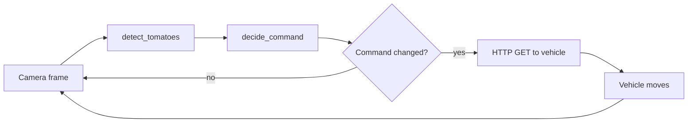

# Method

## Detection pipeline (`tomato_vision/core/`)
1. Flip the frame vertically if the preset says so (`ORIGINAL` does: the robot camera was mounted upside down).
2. Add a brightness offset (`ORIGINAL`: +50, clipped to 0..255; `ADVANCED`: 0).
3. Convert to HSV and OR together one `inRange` mask per hue range. `ADVANCED` uses two ranges because red wraps around hue 0 and 179; the original used only 0 to 14.
4. Clean the mask with a morphological open then close (`ADVANCED` only; the original had this commented out).
5. Take external contours, drop those below `min_area_px`, sort by area (largest first). The original kept only the largest.

The detector is plain colour segmentation. Anything red or orange and large enough can be a candidate, and touching fruit merge into one blob.

## Alignment decision (`control/align.py`)
Frame 255 x 255, dead band 40 px around the frame centre (127.5, 127.5).

| Condition | Command | HTTP code |
|---|---|---|
| no detection | STOP | `s` |
| centre x > 127.5 + 40 | TARGET_RIGHT | `l` |
| centre x < 127.5 - 40 | TARGET_LEFT | `r` |
| x in band, abs(centre y - 127.5) > 40 | ADVANCE | `f` |
| x and y in band | PICK | `sa` |

The table is the intended behaviour. The archived 2023 script never reaches the `sa` branch (see `advancements.md`); the later work does.

`l` for a target on the right and `r` for the left copy the original script; they are tied to the vehicle wiring and the flipped camera. The original sends `f` for a target above and below the band; that is kept.

## Arm mapping (`control/arm_mapping.py`)
These reproduce `ESP-32 Code.ino` with Arduino `map()` semantics (integer division truncating toward zero). The camera does not feed back on the arm angles: they are an open loop map to hobby servos.

| Input (0..255) | Servo | Range (degrees) |
|---|---|---|
| x | base | 20 to 160 |
| y | shoulder | 50 to 150 |
| y | elbow | 50 to 180 |
| z | wrist (pick) | 50 to 150 |

Serial frames: `T,xxx,yyy` and `P,000,zzz` (the firmware reads characters 6 to 8 of a pick frame).

## Control loop

## Alignment simulation (`sim/alignment_sim.py`)
A kinematic toy model, not the robot: each tick the target centre moves `pixels_per_tick` toward the frame centre along the axis the command implies, until the command is PICK. It shows the closed loop converging; it says nothing about real vehicle dynamics.

## Evaluation (`eval/`)
Laboro Tomato, ground truth "fully ripened" (`b_` and `l_`), greedy one to one matching at IoU 0.5, predictions sorted by area. Images are downscaled to a 640 px longest side for detection. `hit@1` is the share of images with a ripe tomato where the single largest detection overlaps a real one at IoU 0.5. Parameters are tuned on the train split only; the test split is run once per preset.
