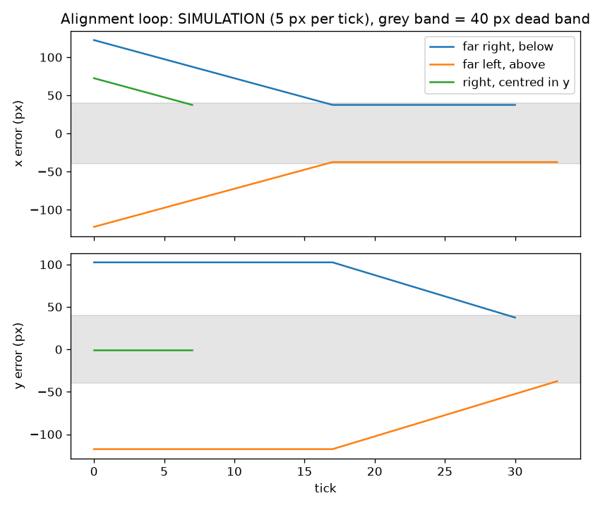

# Results

Reproducible evaluation of the HSV detector on the Laboro Tomato dataset (CC BY-NC-SA 4.0, downloaded by me, not redistributed). Ground truth: "fully ripened" (`b_fully_ripened` and `l_fully_ripened`). Matching: greedy one to one, IoU 0.5, largest detection first. Detection runs on images downscaled to a 640 px longest side. Generated by `python -m tomato_vision.eval.run_eval` (see `results/metrics_*.json`).

## Test split (161 images), each preset run once

| preset | split | images | tp | fp | fn | precision | recall | F1 | hit@1 |
|---|---|---|---|---|---|---|---|---|---|
| original | test | 161 | 46 | 104 | 295 | 0.307 | 0.135 | 0.187 | 0.465 |
| advanced | test | 161 | 106 | 161 | 235 | 0.397 | 0.311 | 0.349 | 0.485 |

`original` uses the settings of the 2023 project (one hue range 0 to 14, brightness +50, largest blob only). `advanced` is the later work, with parameters tuned on the train split.

hit@1 = share of images containing a ripe tomato where the single largest detection overlaps a real one at IoU 0.5 (what the robot needs to pick one).

On the test split `advanced` is ahead of `original` on precision, recall, F1 and hit@1 (it also has more false positives in absolute terms, 161 against 104, because it finds more boxes): precision 0.397 against 0.307, recall 0.311 against 0.135, but hit@1 improves only from 0.465 to 0.485.
Both presets are weak: in more than half of the images with a ripe tomato the largest detection is not a ripe tomato. In a visual check of six test images (no parameter was changed afterwards) the failures were touching tomatoes merged into one box, orange and half ripe fruit counted as ripe, and small distant fruit missed because of the area filter.
The original report gives precision 44 % and recall 92 % for the physical robot (counts only, a different, unreleased trial set). The precision here (0.307 for `original`) is of the same order and the recall is far lower (0.135 here against 92 %); the two are not comparable, because the report's trial set and counting method are not available.

## Train split (643 images, used for tuning)

| preset | split | images | tp | fp | fn | precision | recall | F1 | hit@1 |
|---|---|---|---|---|---|---|---|---|---|
| original | train | 643 | 237 | 381 | 1093 | 0.383 | 0.178 | 0.243 | 0.544 |
| advanced | train | 643 | 496 | 540 | 834 | 0.479 | 0.373 | 0.419 | 0.571 |

## Tuning

Grid search on the train split (`results/tuning_train.json`, 54 combinations of hue upper bound {10, 14, 18}, saturation minimum {47, 80, 120}, value minimum {40, 60}, `min_area_px` {50, 150, 400}), maximising F1. Best: hue upper 10, saturation minimum 120, value minimum 60, `min_area_px` 400 (F1 0.419). All four chosen values sit at an edge of the grid (the lowest hue bound, the highest saturation, value and area values), so a wider grid might do better; it was not explored.

## Alignment simulation

Simulation of the alignment loop (`sim/alignment_sim.py`), not a measurement of the robot.
